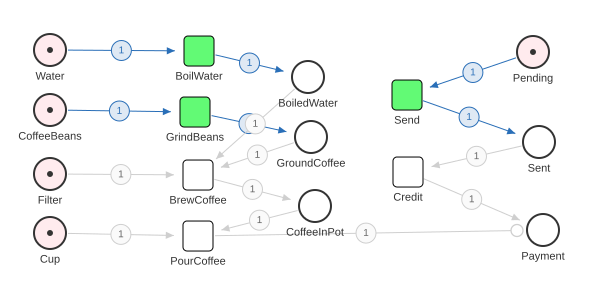

# Coffee Machine State Machine

One Petri net, implemented thirty-nine times: five *forms* across ten languages,
every one of them emitting the byte-identical canonical trace.

[](https://pflow.xyz/?data=%7B%22modelType%22%3A%22petriNet%22%2C%22version%22%3A%22v0%22%2C%22places%22%3A%7B%22Water%22%3A%7B%22offset%22%3A0%2C%22initial%22%3A1%2C%22capacity%22%3A1%2C%22x%22%3A235%2C%22y%22%3A321%7D%2C%22BoiledWater%22%3A%7B%22offset%22%3A1%2C%22capacity%22%3A1%2C%22x%22%3A493%2C%22y%22%3A348%7D%2C%22CoffeeBeans%22%3A%7B%22offset%22%3A2%2C%22initial%22%3A1%2C%22capacity%22%3A1%2C%22x%22%3A235%2C%22y%22%3A381%7D%2C%22GroundCoffee%22%3A%7B%22offset%22%3A3%2C%22capacity%22%3A1%2C%22x%22%3A496%2C%22y%22%3A408%7D%2C%22Filter%22%3A%7B%22offset%22%3A4%2C%22initial%22%3A1%2C%22capacity%22%3A1%2C%22x%22%3A235%2C%22y%22%3A445%7D%2C%22CoffeeInPot%22%3A%7B%22offset%22%3A5%2C%22capacity%22%3A1%2C%22x%22%3A500%2C%22y%22%3A477%7D%2C%22Pending%22%3A%7B%22offset%22%3A6%2C%22initial%22%3A1%2C%22capacity%22%3A1%2C%22x%22%3A718%2C%22y%22%3A323%7D%2C%22Sent%22%3A%7B%22offset%22%3A7%2C%22capacity%22%3A1%2C%22x%22%3A724%2C%22y%22%3A413%7D%2C%22Payment%22%3A%7B%22offset%22%3A8%2C%22capacity%22%3A1%2C%22x%22%3A728%2C%22y%22%3A501%7D%2C%22Cup%22%3A%7B%22offset%22%3A9%2C%22initial%22%3A1%2C%22capacity%22%3A1%2C%22x%22%3A235%2C%22y%22%3A504%7D%7D%2C%22transitions%22%3A%7B%22BoilWater%22%3A%7B%22x%22%3A384%2C%22y%22%3A322%7D%2C%22BrewCoffee%22%3A%7B%22x%22%3A383%2C%22y%22%3A446%7D%2C%22Credit%22%3A%7B%22x%22%3A593%2C%22y%22%3A443%7D%2C%22GrindBeans%22%3A%7B%22x%22%3A380%2C%22y%22%3A383%7D%2C%22PourCoffee%22%3A%7B%22x%22%3A383%2C%22y%22%3A507%7D%2C%22Send%22%3A%7B%22x%22%3A592%2C%22y%22%3A366%7D%7D%2C%22arcs%22%3A%5B%7B%22source%22%3A%22Water%22%2C%22target%22%3A%22BoilWater%22%7D%2C%7B%22source%22%3A%22BoilWater%22%2C%22target%22%3A%22BoiledWater%22%7D%2C%7B%22source%22%3A%22CoffeeBeans%22%2C%22target%22%3A%22GrindBeans%22%7D%2C%7B%22source%22%3A%22GrindBeans%22%2C%22target%22%3A%22GroundCoffee%22%7D%2C%7B%22source%22%3A%22BoiledWater%22%2C%22target%22%3A%22BrewCoffee%22%7D%2C%7B%22source%22%3A%22GroundCoffee%22%2C%22target%22%3A%22BrewCoffee%22%7D%2C%7B%22source%22%3A%22Filter%22%2C%22target%22%3A%22BrewCoffee%22%7D%2C%7B%22source%22%3A%22BrewCoffee%22%2C%22target%22%3A%22CoffeeInPot%22%7D%2C%7B%22source%22%3A%22CoffeeInPot%22%2C%22target%22%3A%22PourCoffee%22%7D%2C%7B%22source%22%3A%22Cup%22%2C%22target%22%3A%22PourCoffee%22%7D%2C%7B%22source%22%3A%22Pending%22%2C%22target%22%3A%22Send%22%7D%2C%7B%22source%22%3A%22Send%22%2C%22target%22%3A%22Sent%22%7D%2C%7B%22source%22%3A%22Sent%22%2C%22target%22%3A%22Credit%22%7D%2C%7B%22source%22%3A%22Credit%22%2C%22target%22%3A%22Payment%22%7D%2C%7B%22source%22%3A%22PourCoffee%22%2C%22target%22%3A%22Payment%22%2C%22inhibit%22%3Atrue%7D%5D%7D)

Click the image to open the model in the [pflow.xyz](https://pflow.xyz)
editor (the model itself travels in the link — nothing server-side to rot).
The image is [`model.svg`](model.svg), committed and rendered from
[`model.json`](model.json) by pflow-xyz's SVG generator; `model.json` is also
what `tools/codegen` reads.

## The model

- **Places** hold tokens: `Water`, `BoiledWater`, `GroundCoffee`, `CoffeeInPot`, …
- **Transitions** move them: `BoilWater`, `GrindBeans`, `BrewCoffee`, `PourCoffee`, `Send`, `Credit`
- **Arcs** wire places to transitions and back
- **One guard**: `PourCoffee` requires `Payment` to be present, and does not
  consume it — you cannot pour before paying

The net is 1-safe: a place holds zero or one token, and a transition that would
produce into an already-marked place is not enabled.

## The canonical trace

Every implementation prints exactly this, and nothing else:

```
Step #1: BoilWater => BoiledWater,CoffeeBeans,Cup,Filter,Pending
Step #2: GrindBeans => BoiledWater,Cup,Filter,GroundCoffee,Pending
Step #3: BrewCoffee => CoffeeInPot,Cup,Pending
Step #4: Send => CoffeeInPot,Cup,Sent
Step #5: Credit => CoffeeInPot,Cup,Payment
Step #6: PourCoffee => Payment
```

That text is [`parity/trace.golden`](parity/trace.golden) — the contract every
implementation is held to. The transition name, then the marking as place names
sorted lexicographically. Sorting is not cosmetic: it is the only reason a Go
`map`, a Rust `HashSet`, a Python `set` and a JS `Set` can be compared at all.

The implementations are independent rewrites, so an identical trace is a real
claim about the model rather than a shared-code tautology.

**It is one trace of twenty.** This net has real concurrency — at the opening
marking, `BoilWater`, `GrindBeans` and `Send` are all enabled, and 9 of its 16
reachable markings offer a choice. Thirty-nine programs agree on these six lines
because they all implement one declared rule: *fire the enabled transition whose
name is lexicographically least.* That rule is normative and lives in
[FORMS.md](FORMS.md#canonical-scheduling-policy); the golden is what enforces it.

What the rule does not decide is the outcome. All 20 maximal firing sequences
end in `{Payment}` — the net is confluent, which the [proof](FORMS.md#proof)
form checks exhaustively. The scheduling policy chooses which trace gets
printed, not where the machine ends up.

## The five forms

The interesting variation is not "the same program in ten syntaxes" — it is
*how the model is encoded*. Five strategies recur:

| Form | The net is… | Firing order comes from… |
|------|-------------|--------------------------|
| **interpreter** | runtime data (`arrows`, `guards`) | a scheduler searching sorted candidates |
| **lambda** | pure `State → State` functions | the policy's sequence, precomputed into a fixed composition |
| **generated** | a build-time input (`model.json`) | a generated scheduler, same sorted search |
| **contract** | a public API surface | the *caller* — who must supply the policy's sequence |
| **proof** | a claim about *every* reachable marking | the same policy, run only after the claim is checked |

All five cite one rule, the [canonical scheduling
policy](FORMS.md#canonical-scheduling-policy). They differ in *where* the firing
order is decided, not in *what* it is.

[FORMS.md](FORMS.md) specifies each one precisely, including why all five are
held to a single golden trace rather than one golden per form.

## The form × language matrix

| | interpreter | lambda | generated | contract | proof |
|---|---|---|---|---|---|
| **Go** | ✅ | ✅ | ✅ | ✅ | ✅ |
| **Rust** | ✅ | ✅ | ✅ | ✅ | ✅ |
| **Python** | ✅ | ✅ | ✅ | ✅ | ✅ |
| **JavaScript** | ✅ | ✅ | ✅ | ✅ | ✅ |
| **Ruby** | ✅ | ✅ | — | ✅ | — |
| **Julia** | ✅ | ✅ | — | ✅ | — |
| **Haskell** | ✅ | ✅ | — | ✅ | — |
| **Bash** | ✅ | ✅ | — | ✅ | ✅ |
| **Lean** | ✅ | ✅ | — | ✅ | ✅ |
| **Solidity** | — | — | ✅ | ✅ | — |

Thirty-nine programs. The gaps are deliberate:

- **generated** exists for the four languages `tools/codegen` targets, plus
  Solidity. Adding a language means adding one template — see below.
- **Solidity** has no scheduler and no stdout, so interpreter and lambda have
  nowhere to land. Contract is the form the language forces on you, which is
  exactly why it is worth showing. It also cannot model-check itself at
  startup, so proof has nowhere to land either.
- **proof** exists everywhere it could be *run* on this repo's own gates:
  the four Bazel languages, plus Bash and Lean on the native gate. The Ruby,
  Julia and Haskell entries are welcome contributions — the spec is in
  [FORMS.md](FORMS.md#proof).

Layout is uniform: `<lang>/<form>` where the language needs directories (Go,
Rust) and `<lang>/<form>.<ext>` where it does not.

## Running them

```
make all            # every form in every locally available language
make run-go         # all five Go forms      (also run-rust, run-python, run-js)
make run-bash       # all four Bash forms    (also run-lean)
make run-ruby       # all three Ruby forms   (also run-julia, run-haskell)
make help
```

## Parity gates

Two gates, because two kinds of toolchain:

```
make parity         # bazel test //... — the 20 in-graph programs, hermetically
make parity-native  # ruby, julia, haskell, bash, lean against the same golden
```

**`make parity`** builds Go, Rust, Python and JavaScript under hermetic
toolchains (Go SDK 1.26.0, Rust 1.86.0, Node 22.14.0, CPython 3.12), runs all
twenty programs, and diffs each one's stdout against the golden. If any drifts,
the build fails and the diff names it. It also runs three artifact gates in
`//tools/codegen`:

| Test | Fails when |
|------|-----------|
| `codegen_up_to_date_test` | a checked-in generated file has gone stale |
| `codegen_permutation_test` | regenerating from a reordered `model.json` changes the output — i.e. the generator leaked JSON key order into the code |
| `reachability_test` | `parity/reachability.golden` is stale, is not permutation-invariant, or disagrees with `parity/trace.golden` |

## The second golden

[`parity/reachability.golden`](parity/reachability.golden) is the net's full
reachable state space — 16 markings, 26 edges, one terminal marking — with the
transitions enabled in each and where they lead.

The trace golden pins one path; this pins the machine. A single trace is equally
consistent with a net that never offers a choice, so by itself it cannot tell
"these thirty-nine programs agree about this machine" apart from "they agree
about one path through a machine none of them has explored". The proof forms in
six languages each compute this space privately and throw it away; writing it
down once means they can be checked against each other instead of each being
trusted on its own.

Pins match the ecosystem-wide line (rules_go 0.61.1 / gazelle 0.51.3 / Go SDK
1.26.0) so compiled actions share cache keys with the other Bazel repos in the
Workspace. The shared remote cache is opt-in and read-only by default:

```
bazel test --config=remote //...     # needs ~/.netrc for bazel.stackdump.com
```

**`make parity-native`** covers what Bazel does not. It runs whichever of
ruby/julia/haskell/bash are installed and **skips** the rest — loudly. A run
where everything skipped exits 0 but says `NOTHING CHECKED`, so a missing
toolchain can never masquerade as a pass.

**Solidity is in neither gate.** There is no hermetic solc here and a contract
has no stdout; the event log is the trace, which would need an EVM to observe.
Both `.sol` files compile clean under solc 0.8.24, and the generated one is
still covered by the codegen drift test — but nothing asserts their behaviour.
That is the one honest gap in the matrix.

## Code generation

[`model.json`](model.json) is the source of truth for the generated form.

```
make generate         # regenerate every <lang>/generated from model.json
make check-generated  # fail if any of them is stale
```

Generated files carry a `DO NOT EDIT` header and are checked in, so the repo
stays readable without running the generator. `tools/codegen` is a single Go
program with one `text/template` per target language
([`tools/codegen/templates/`](tools/codegen/templates/)); adding a language is
one template plus one line in the `langs` map.

Output is deterministic — places, transitions and arc lists are all sorted by
name — which is what makes the drift test possible.

Sorting is also what makes the generated scheduler an implementation of the
canonical scheduling policy rather than a coincidence — see below.

## Per-language notes

Native test suites, where they exist:

```
cd golang && go test ./...
cargo test --manifest-path rust/Cargo.toml
cd python && PYTHONPATH=. python3 test/main_test.py
cd javascript && npm install && npm test        # mocha; not in the Bazel graph
```

- **Python**'s lambda form is `lambda_form.py` because `lambda` is a keyword.
- **Ruby**'s contract form spells `Send` as `send_order`, because `Object#send`
  is Ruby's reflection entry point and overriding it on a public API object is a
  trap.
- **Haskell**'s lambda form is the one that needs no scaffolding: `Maybe
  Marking` *is* "(marking, fired)", and the purity the other languages arrange
  by copying is free.
- **Julia**'s enum members carry the canonical CamelCase names directly, so
  `string(t)` gives the trace spelling with no name table.
- **Lean**'s interpreter form is the only implementation that has to *declare*
  it might not terminate: the scheduler loop is `partial def`, because "runs
  until no transition is enabled" is a property of this net rather than
  something the compiler can see. The lambda and contract forms need no such
  escape hatch — they recurse structurally on a finite schedule. Lean is also
  the one language here with no set type in scope without pulling in a library,
  so the marking is a `List State`; the 1-safe invariant is what makes that
  honest, and it is checked, not assumed, on every fire.
- The **proof** form makes that check a theorem. In Go, Rust, Python,
  JavaScript and Bash it is an exhaustive model-check at startup, every run;
  in Lean the same breadth-first search runs inside the kernel via `decide`,
  and an unsafe net is a *compile error* — `main` cannot exist unless
  1-safety and the unique `{Payment}` deadlock hold. See
  [FORMS.md](FORMS.md#proof).
- **JavaScript**'s mocha suite needs npm, which does not fit the dependency-free
  hermetic Node setup, so it stays outside `bazel test`.

## Contributing

New languages and new forms are both welcome. The bar is the same either way:
it must emit the canonical trace, and it must be wired into one of the two
parity gates. Start from [FORMS.md](FORMS.md) — it is the spec, not a
description.
